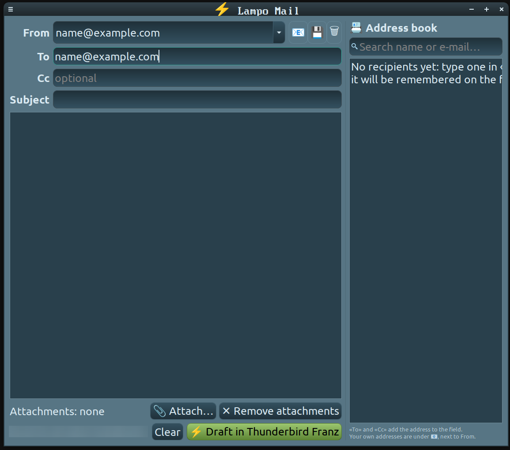

<a id="top"></a>

# ⚡ Lampo Mail


[](https://www.paypal.com/donate/?hosted_button_id=HUF5MYDG465RY)



[🇬🇧 English](#english) · [🇮🇹 Italiano](#italiano) · [🇩🇪 Deutsch](#deutsch) · [🇪🇸 Español](#espanol) · [🇫🇷 Français](#francais) · [🇳🇱 Nederlands](#nederlands) · [🇷🇺 Русский](#russkiy) · [🇸🇦 العربية](#arabic) · [🇨🇳 中文](#zhongwen) · [🇯🇵 日本語](#nihongo)

---

<a id="english"></a>

## 🇬🇧 English

**Lampo Mail** (*lampo* is Italian for *lightning*) is a tiny GTK app for Linux that prepares an e-mail in a flash and hands it to **your own mail program**. You write, Lampo Mail fills in the draft — the sending stays your gesture: nothing ever leaves on its own.

### ✨ Features

- **Your default mail program** — the draft opens in the program that handles `mailto:` links on your system. With Thunderbird the sender and the attachments are passed too; with any other program the Linux standard `xdg-email` is used.
- **It remembers** — the senders and recipients you use are kept for next time; a 🗑 removes any address you no longer want.
- **Address book at hand** — a panel on the right with search and «To» / «Cc» buttons; typing in a field also suggests addresses.
- **Attachments** — add as many files as you like; they go straight into the draft.
- **Email Picker friendly** — if you use Email Picker, your own addresses are one click away as sender (📧), and 💾 saves a new sender into one of its sections (after a backup copy). *Needs the next release of [Email Picker](https://github.com/FranzBias/email-picker), coming soon.*
- **Italian and English** — follows the system language (`LAMPO_MAIL_LANG=it` or `en` to choose).

### 🛠️ Requirements

- Linux with Python **3.8+** and GTK 3; for programs other than Thunderbird, `xdg-utils` (`xdg-email`).

```bash
sudo apt install python3-gi gir1.2-gtk-3.0 xdg-utils
```

### 📦 Installation

```bash
git clone https://github.com/FranzBias/Lampo-Mail.git
cd Lampo-Mail
./install.sh        # installs for your user only, no sudo needed
```

You will find **Lampo Mail** in the menu. To remove it: `./uninstall.sh`. Prefer not to install? Just run `python3 src/Lampo-Mail.py`.

### 🚀 Usage

1. Write the sender (or pick it with 📧), the recipients, the subject and the text.
2. Add attachments if you need them.
3. Press **⚡ Draft in …** (or Ctrl+Enter): the draft opens in your mail program, ready — check it and press *Send*.

### 🔒 Privacy

- Lampo Mail has no network access at all: it only talks to your mail program.
- Remembered addresses are stored on your computer in `~/.config/lampo-mail/config.json`.

### 🤝 Companion apps

Lampo Mail is a sister of my **[Command Swiss Army Knife](https://github.com/FranzBias/Command-Swiss-Army-Knife)**: when Lampo Mail is installed, a button to open it appears in CSAK. Another little app of mine: **[Smorfia](https://github.com/FranzBias/Smorfia)**, an emoji picker.

### 📄 License

[MIT](LICENSE) — made with ❤️ by Francesco

<sub>[⬆ Top](#top)</sub>

---

<a id="italiano"></a>

## 🇮🇹 Italiano

**Lampo Mail** è una piccola app GTK per Linux che prepara un'email in un lampo e la passa al **tuo programma di posta**. Tu scrivi, Lampo Mail compila la bozza: l'invio resta un tuo gesto, non parte mai niente da solo.

### ✨ Funzionalità

- **Il tuo programma di posta predefinito** — la bozza si apre nel programma che sul tuo sistema gestisce i link `mailto:`. Con Thunderbird passano anche mittente e allegati; con gli altri programmi si usa lo standard di Linux `xdg-email`.
- **Si ricorda** — mittenti e destinatari usati restano per la volta dopo; un 🗑 toglie gli indirizzi che non vuoi più.
- **Rubrica a portata di mano** — un pannello a destra con ricerca e pulsanti «A» / «Cc»; scrivendo in un campo arrivano anche i suggerimenti.
- **Allegati** — aggiungi tutti i file che vuoi, finiscono direttamente nella bozza.
- **Amica di Email Picker** — se usi Email Picker, i tuoi indirizzi sono a un clic come Mittente (📧), e 💾 salva un nuovo mittente in una delle sue sezioni (dopo una copia di sicurezza). *Richiede la prossima versione di [Email Picker](https://github.com/FranzBias/email-picker), in arrivo.*
- **Italiano e inglese** — segue la lingua del sistema (`LAMPO_MAIL_LANG=it` o `en` per scegliere).

### 🛠️ Requisiti

- Linux con Python **3.8+** e GTK 3; per programmi diversi da Thunderbird, `xdg-utils` (`xdg-email`).

```bash
sudo apt install python3-gi gir1.2-gtk-3.0 xdg-utils
```

### 📦 Installazione

```bash
git clone https://github.com/FranzBias/Lampo-Mail.git
cd Lampo-Mail
./install.sh        # installa solo per il tuo utente, senza sudo
```

Troverai **Lampo Mail** nel menu. Per toglierla: `./uninstall.sh`. Preferisci non installare? Basta `python3 src/Lampo-Mail.py`.

### 🚀 Uso

1. Scrivi il mittente (o sceglilo con 📧), i destinatari, l'oggetto e il testo.
2. Aggiungi gli allegati, se servono.
3. Premi **⚡ Prepara in …** (o Ctrl+Invio): la bozza si apre nel tuo programma di posta, pronta — controllala e premi *Invia*.

### 🔒 Privacy

- Lampo Mail non usa la rete: parla solo con il tuo programma di posta.
- Gli indirizzi ricordati restano sul tuo computer, in `~/.config/lampo-mail/config.json`.

### 🤝 App compagne

Lampo Mail è sorella della mia **[Command Swiss Army Knife](https://github.com/FranzBias/Command-Swiss-Army-Knife)**: quando Lampo Mail è installata, in CSAK compare un pulsante per aprirla. Un'altra mia piccola app: **[Smorfia](https://github.com/FranzBias/Smorfia)**, un selettore di emoji.

### 📄 Licenza

[MIT](LICENSE) — made with ❤️ by Francesco

<sub>[⬆ Top](#top)</sub>

---

<a id="deutsch"></a>

## 🇩🇪 Deutsch

**Lampo Mail** (*lampo* ist Italienisch für *Blitz*) ist eine kleine GTK-App für Linux, die blitzschnell eine E-Mail vorbereitet und sie an **dein eigenes Mailprogramm** übergibt. Du schreibst, Lampo Mail füllt den Entwurf aus — das Senden bleibt deine Entscheidung: nichts geht von allein raus.

### ✨ Funktionen

- **Dein Standard-Mailprogramm** — der Entwurf öffnet sich in dem Programm, das auf deinem System `mailto:`-Links verarbeitet. Bei Thunderbird werden auch Absender und Anhänge übergeben; bei anderen Programmen wird der Linux-Standard `xdg-email` verwendet.
- **Merkt sich alles** — benutzte Absender und Empfänger bleiben fürs nächste Mal; ein 🗑 entfernt Adressen, die du nicht mehr brauchst.
- **Adressbuch griffbereit** — ein Feld rechts mit Suche und den Knöpfen «An» / «Cc»; beim Tippen gibt es auch Vorschläge.
- **Anhänge** — beliebig viele Dateien, sie landen direkt im Entwurf.
- **Versteht sich mit Email Picker** — wenn du Email Picker nutzt, sind deine eigenen Adressen mit einem Klick als Absender da (📧), und 💾 speichert einen neuen Absender in einem seiner Bereiche (nach einer Sicherungskopie). *Benötigt die nächste Version von [Email Picker](https://github.com/FranzBias/email-picker), bald verfügbar.*
- **Italienisch und Englisch** — folgt der Systemsprache (`LAMPO_MAIL_LANG=it` oder `en` zum Festlegen).

### 🛠️ Voraussetzungen

- Linux mit Python **3.8+** und GTK 3; für andere Programme als Thunderbird `xdg-utils` (`xdg-email`).

```bash
sudo apt install python3-gi gir1.2-gtk-3.0 xdg-utils
```

### 📦 Installation

```bash
git clone https://github.com/FranzBias/Lampo-Mail.git
cd Lampo-Mail
./install.sh        # installiert nur für deinen Benutzer, ohne sudo
```

Du findest **Lampo Mail** im Menü. Entfernen: `./uninstall.sh`. Ohne Installation: einfach `python3 src/Lampo-Mail.py`.

### 🚀 Verwendung

1. Absender eingeben (oder mit 📧 wählen), Empfänger, Betreff und Text.
2. Bei Bedarf Anhänge hinzufügen.
3. **⚡ Entwurf in …** drücken (oder Strg+Enter): der Entwurf öffnet sich fertig in deinem Mailprogramm — prüfen und *Senden* drücken.

### 🔒 Datenschutz

- Lampo Mail nutzt kein Netzwerk: es spricht nur mit deinem Mailprogramm.
- Gemerkte Adressen bleiben auf deinem Rechner, in `~/.config/lampo-mail/config.json`.

### 🤝 Begleit-Apps

Lampo Mail ist die Schwester meiner App **[Command Swiss Army Knife](https://github.com/FranzBias/Command-Swiss-Army-Knife)**: ist Lampo Mail installiert, erscheint in CSAK ein Knopf zum Öffnen. Noch eine kleine App von mir: **[Smorfia](https://github.com/FranzBias/Smorfia)**, eine Emoji-Auswahl.

### 📄 Lizenz

[MIT](LICENSE) — made with ❤️ by Francesco

<sub>[⬆ Top](#top)</sub>

---

<a id="espanol"></a>

## 🇪🇸 Español

**Lampo Mail** (*lampo* significa *relámpago* en italiano) es una pequeña app GTK para Linux que prepara un correo en un instante y lo pasa a **tu propio programa de correo**. Tú escribes, Lampo Mail rellena el borrador — el envío sigue siendo cosa tuya: nunca sale nada solo.

### ✨ Características

- **Tu programa de correo predeterminado** — el borrador se abre en el programa que gestiona los enlaces `mailto:` en tu sistema. Con Thunderbird se pasan también el remitente y los adjuntos; con cualquier otro se usa el estándar de Linux `xdg-email`.
- **Recuerda** — los remitentes y destinatarios que usas se guardan para la próxima vez; un 🗑 quita las direcciones que ya no quieres.
- **Libreta a mano** — un panel a la derecha con búsqueda y botones «Para» / «Cc»; al escribir en un campo también aparecen sugerencias.
- **Adjuntos** — añade todos los archivos que quieras, van directos al borrador.
- **Amiga de Email Picker** — si usas Email Picker, tus propias direcciones están a un clic como remitente (📧), y 💾 guarda un remitente nuevo en una de sus secciones (tras una copia de seguridad). *Requiere la próxima versión de [Email Picker](https://github.com/FranzBias/email-picker), muy pronto.*
- **Italiano e inglés** — sigue el idioma del sistema (`LAMPO_MAIL_LANG=it` o `en` para elegir).

### 🛠️ Requisitos

- Linux con Python **3.8+** y GTK 3; para programas distintos de Thunderbird, `xdg-utils` (`xdg-email`).

```bash
sudo apt install python3-gi gir1.2-gtk-3.0 xdg-utils
```

### 📦 Instalación

```bash
git clone https://github.com/FranzBias/Lampo-Mail.git
cd Lampo-Mail
./install.sh        # instala solo para tu usuario, sin sudo
```

Encontrarás **Lampo Mail** en el menú. Para quitarla: `./uninstall.sh`. ¿Prefieres no instalar? Basta con `python3 src/Lampo-Mail.py`.

### 🚀 Uso

1. Escribe el remitente (o elígelo con 📧), los destinatarios, el asunto y el texto.
2. Añade adjuntos si los necesitas.
3. Pulsa **⚡ Borrador en …** (o Ctrl+Intro): el borrador se abre listo en tu programa de correo — revísalo y pulsa *Enviar*.

### 🔒 Privacidad

- Lampo Mail no usa la red: solo habla con tu programa de correo.
- Las direcciones recordadas se quedan en tu ordenador, en `~/.config/lampo-mail/config.json`.

### 🤝 Apps compañeras

Lampo Mail es hermana de mi **[Command Swiss Army Knife](https://github.com/FranzBias/Command-Swiss-Army-Knife)**: cuando Lampo Mail está instalada, aparece en CSAK un botón para abrirla. Otra pequeña app mía: **[Smorfia](https://github.com/FranzBias/Smorfia)**, un selector de emojis.

### 📄 Licencia

[MIT](LICENSE) — made with ❤️ by Francesco

<sub>[⬆ Top](#top)</sub>

---

<a id="francais"></a>

## 🇫🇷 Français

**Lampo Mail** (*lampo* veut dire *éclair* en italien) est une petite appli GTK pour Linux qui prépare un e-mail en un éclair et le confie à **ton propre logiciel de messagerie**. Tu écris, Lampo Mail remplit le brouillon — l'envoi reste ton geste : rien ne part tout seul.

### ✨ Fonctionnalités

- **Ton logiciel de messagerie par défaut** — le brouillon s'ouvre dans le programme qui gère les liens `mailto:` sur ton système. Avec Thunderbird, l'expéditeur et les pièces jointes sont aussi transmis ; avec les autres programmes, le standard Linux `xdg-email` est utilisé.
- **Elle se souvient** — les expéditeurs et destinataires utilisés sont gardés pour la prochaine fois ; un 🗑 retire les adresses dont tu ne veux plus.
- **Carnet d'adresses à portée de main** — un panneau à droite avec recherche et boutons «À» / «Cc» ; en tapant dans un champ, des suggestions apparaissent aussi.
- **Pièces jointes** — ajoute autant de fichiers que tu veux, ils vont directement dans le brouillon.
- **Amie d'Email Picker** — si tu utilises Email Picker, tes propres adresses sont à un clic comme expéditeur (📧), et 💾 enregistre un nouvel expéditeur dans une de ses sections (après une copie de sauvegarde). *Nécessite la prochaine version d'[Email Picker](https://github.com/FranzBias/email-picker), bientôt disponible.*
- **Italien et anglais** — suit la langue du système (`LAMPO_MAIL_LANG=it` ou `en` pour choisir).

### 🛠️ Prérequis

- Linux avec Python **3.8+** et GTK 3 ; pour les programmes autres que Thunderbird, `xdg-utils` (`xdg-email`).

```bash
sudo apt install python3-gi gir1.2-gtk-3.0 xdg-utils
```

### 📦 Installation

```bash
git clone https://github.com/FranzBias/Lampo-Mail.git
cd Lampo-Mail
./install.sh        # installe pour ton utilisateur seulement, sans sudo
```

Tu trouveras **Lampo Mail** dans le menu. Pour la retirer : `./uninstall.sh`. Tu préfères ne pas installer ? Lance simplement `python3 src/Lampo-Mail.py`.

### 🚀 Utilisation

1. Écris l'expéditeur (ou choisis-le avec 📧), les destinataires, l'objet et le texte.
2. Ajoute des pièces jointes si besoin.
3. Appuie sur **⚡ Brouillon dans …** (ou Ctrl+Entrée) : le brouillon s'ouvre, prêt, dans ton logiciel de messagerie — vérifie-le et appuie sur *Envoyer*.

### 🔒 Confidentialité

- Lampo Mail n'utilise pas le réseau : elle ne parle qu'à ton logiciel de messagerie.
- Les adresses retenues restent sur ton ordinateur, dans `~/.config/lampo-mail/config.json`.

### 🤝 Applis compagnes

Lampo Mail est la sœur de mon appli **[Command Swiss Army Knife](https://github.com/FranzBias/Command-Swiss-Army-Knife)** : quand Lampo Mail est installée, un bouton pour l'ouvrir apparaît dans CSAK. Une autre petite appli à moi : **[Smorfia](https://github.com/FranzBias/Smorfia)**, un sélecteur d'emojis.

### 📄 Licence

[MIT](LICENSE) — made with ❤️ by Francesco

<sub>[⬆ Top](#top)</sub>

---

<a id="nederlands"></a>

## 🇳🇱 Nederlands

**Lampo Mail** (*lampo* is Italiaans voor *bliksem*) is een kleine GTK-app voor Linux die bliksemsnel een e-mail voorbereidt en doorgeeft aan **je eigen mailprogramma**. Jij schrijft, Lampo Mail vult het concept in — het verzenden blijft jouw gebaar: er gaat nooit iets vanzelf weg.

### ✨ Functies

- **Je standaard mailprogramma** — het concept opent in het programma dat op je systeem `mailto:`-links afhandelt. Bij Thunderbird gaan ook afzender en bijlagen mee; bij andere programma's wordt de Linux-standaard `xdg-email` gebruikt.
- **Onthoudt alles** — gebruikte afzenders en ontvangers blijven bewaard voor de volgende keer; een 🗑 verwijdert adressen die je niet meer wilt.
- **Adresboek bij de hand** — een paneel rechts met zoeken en de knoppen «Aan» / «Cc»; tijdens het typen verschijnen ook suggesties.
- **Bijlagen** — voeg zoveel bestanden toe als je wilt, ze gaan direct in het concept.
- **Vriend van Email Picker** — gebruik je Email Picker, dan zijn je eigen adressen met één klik beschikbaar als afzender (📧), en 💾 slaat een nieuwe afzender op in een van zijn secties (na een reservekopie). *Vereist de volgende versie van [Email Picker](https://github.com/FranzBias/email-picker), binnenkort beschikbaar.*
- **Italiaans en Engels** — volgt de systeemtaal (`LAMPO_MAIL_LANG=it` of `en` om te kiezen).

### 🛠️ Vereisten

- Linux met Python **3.8+** en GTK 3; voor andere programma's dan Thunderbird `xdg-utils` (`xdg-email`).

```bash
sudo apt install python3-gi gir1.2-gtk-3.0 xdg-utils
```

### 📦 Installatie

```bash
git clone https://github.com/FranzBias/Lampo-Mail.git
cd Lampo-Mail
./install.sh        # installeert alleen voor jouw gebruiker, zonder sudo
```

Je vindt **Lampo Mail** in het menu. Verwijderen: `./uninstall.sh`. Liever niet installeren? Gewoon `python3 src/Lampo-Mail.py`.

### 🚀 Gebruik

1. Vul de afzender in (of kies hem met 📧), de ontvangers, het onderwerp en de tekst.
2. Voeg zo nodig bijlagen toe.
3. Druk op **⚡ Concept in …** (of Ctrl+Enter): het concept opent klaar in je mailprogramma — controleer het en druk op *Verzenden*.

### 🔒 Privacy

- Lampo Mail gebruikt geen netwerk: het praat alleen met je mailprogramma.
- Onthouden adressen blijven op je computer, in `~/.config/lampo-mail/config.json`.

### 🤝 Begeleidende apps

Lampo Mail is de zus van mijn **[Command Swiss Army Knife](https://github.com/FranzBias/Command-Swiss-Army-Knife)**: als Lampo Mail geïnstalleerd is, verschijnt in CSAK een knop om het te openen. Nog een kleine app van mij: **[Smorfia](https://github.com/FranzBias/Smorfia)**, een emoji-kiezer.

### 📄 Licentie

[MIT](LICENSE) — made with ❤️ by Francesco

<sub>[⬆ Top](#top)</sub>

---

<a id="russkiy"></a>

## 🇷🇺 Русский

**Lampo Mail** (*lampo* по-итальянски — *молния*) — маленькое GTK-приложение для Linux, которое молниеносно готовит письмо и передаёт его **вашей собственной почтовой программе**. Вы пишете, Lampo Mail заполняет черновик — отправка остаётся за вами: ничего не уходит само.

### ✨ Возможности

- **Ваша почтовая программа по умолчанию** — черновик открывается в программе, которая обрабатывает ссылки `mailto:` в вашей системе. С Thunderbird передаются также отправитель и вложения; с другими программами используется стандарт Linux `xdg-email`.
- **Всё помнит** — использованные отправители и получатели сохраняются на следующий раз; 🗑 удаляет ненужные адреса.
- **Адресная книга под рукой** — панель справа с поиском и кнопками «Кому» / «Копия»; при вводе в поле появляются подсказки.
- **Вложения** — добавляйте сколько угодно файлов, они сразу попадают в черновик.
- **Дружит с Email Picker** — если вы пользуетесь Email Picker, ваши адреса доступны одним щелчком как отправитель (📧), а 💾 сохраняет нового отправителя в один из его разделов (после резервной копии). *Требуется следующая версия [Email Picker](https://github.com/FranzBias/email-picker), скоро.*
- **Итальянский и английский** — следует языку системы (`LAMPO_MAIL_LANG=it` или `en` для выбора).

### 🛠️ Требования

- Linux с Python **3.8+** и GTK 3; для программ, отличных от Thunderbird, — `xdg-utils` (`xdg-email`).

```bash
sudo apt install python3-gi gir1.2-gtk-3.0 xdg-utils
```

### 📦 Установка

```bash
git clone https://github.com/FranzBias/Lampo-Mail.git
cd Lampo-Mail
./install.sh        # устанавливается только для вашего пользователя, без sudo
```

**Lampo Mail** появится в меню. Удалить: `./uninstall.sh`. Не хотите устанавливать? Просто `python3 src/Lampo-Mail.py`.

### 🚀 Использование

1. Укажите отправителя (или выберите его через 📧), получателей, тему и текст.
2. При необходимости добавьте вложения.
3. Нажмите **⚡ Черновик в …** (или Ctrl+Enter): готовый черновик откроется в почтовой программе — проверьте и нажмите *Отправить*.

### 🔒 Конфиденциальность

- Lampo Mail не использует сеть: она общается только с вашей почтовой программой.
- Запомненные адреса хранятся на вашем компьютере в `~/.config/lampo-mail/config.json`.

### 🤝 Приложения-компаньоны

Lampo Mail — сестра моего приложения **[Command Swiss Army Knife](https://github.com/FranzBias/Command-Swiss-Army-Knife)**: если Lampo Mail установлена, в CSAK появляется кнопка для её запуска. Ещё одно моё небольшое приложение — **[Smorfia](https://github.com/FranzBias/Smorfia)**, выбор эмодзи.

### 📄 Лицензия

[MIT](LICENSE) — made with ❤️ by Francesco

<sub>[⬆ Top](#top)</sub>

---

<a id="arabic"></a>

## 🇸🇦 العربية

**Lampo Mail** (*lampo* تعني *البرق* بالإيطالية) تطبيق GTK صغير لنظام Linux يجهّز رسالة بريد في لمح البصر ويسلّمها إلى **برنامج البريد الخاص بك**. أنت تكتب، وLampo Mail يملأ المسودة — أما الإرسال فيبقى قرارك: لا يُرسل شيء من تلقاء نفسه.

### ✨ المزايا

- **برنامج البريد الافتراضي لديك** — تُفتح المسودة في البرنامج الذي يعالج روابط `mailto:` على نظامك. مع Thunderbird يُمرَّر المرسل والمرفقات أيضًا؛ ومع البرامج الأخرى يُستخدم معيار Linux ‏`xdg-email`.
- **يتذكّر** — يحتفظ بالمرسلين والمستلمين الذين تستخدمهم للمرة القادمة؛ وزر 🗑 يحذف العناوين التي لم تعد تريدها.
- **دفتر العناوين في متناولك** — لوحة على اليمين مع بحث وزرّي «إلى» / «نسخة»؛ وتظهر اقتراحات أثناء الكتابة.
- **المرفقات** — أضف ما تشاء من الملفات، فتذهب مباشرة إلى المسودة.
- **صديق Email Picker** — إن كنت تستخدم Email Picker فعناوينك متاحة بنقرة كمرسل (📧)، و💾 يحفظ مرسلًا جديدًا في أحد أقسامه (بعد نسخة احتياطية). *يتطلب الإصدار القادم من [Email Picker](https://github.com/FranzBias/email-picker)، قريبًا.*
- **الإيطالية والإنجليزية** — يتبع لغة النظام (`LAMPO_MAIL_LANG=it` أو `en` للاختيار).

### 🛠️ المتطلبات

- Linux مع Python ‏**3.8+** وGTK 3؛ وللبرامج غير Thunderbird ‏`xdg-utils` ‏(`xdg-email`).

```bash
sudo apt install python3-gi gir1.2-gtk-3.0 xdg-utils
```

### 📦 التثبيت

```bash
git clone https://github.com/FranzBias/Lampo-Mail.git
cd Lampo-Mail
./install.sh        # يثبّت لمستخدمك فقط، دون sudo
```

ستجد **Lampo Mail** في القائمة. لإزالته: `./uninstall.sh`. لا تريد التثبيت؟ يكفي `python3 src/Lampo-Mail.py`.

### 🚀 الاستخدام

1. اكتب المرسل (أو اختره عبر 📧) والمستلمين والموضوع والنص.
2. أضف المرفقات إن احتجت.
3. اضغط **⚡ مسودة في …** (أو Ctrl+Enter): تُفتح المسودة جاهزة في برنامج البريد — راجعها واضغط *إرسال*.

### 🔒 الخصوصية

- لا يستخدم Lampo Mail الشبكة: يتحدث فقط مع برنامج البريد لديك.
- تبقى العناوين المحفوظة على حاسوبك في `~/.config/lampo-mail/config.json`.

### 🤝 التطبيقات المرافقة

Lampo Mail شقيق تطبيقي **[Command Swiss Army Knife](https://github.com/FranzBias/Command-Swiss-Army-Knife)**: عند تثبيت Lampo Mail يظهر في CSAK زر لفتحه. ومن تطبيقاتي الصغيرة الأخرى أيضًا **[Smorfia](https://github.com/FranzBias/Smorfia)**، منتقي الرموز التعبيرية.

### 📄 الترخيص

[MIT](LICENSE) — made with ❤️ by Francesco

<sub>[⬆ Top](#top)</sub>

---

<a id="zhongwen"></a>

## 🇨🇳 中文

**Lampo Mail**（*lampo* 在意大利语中意为*闪电*）是一个适用于 Linux 的小巧 GTK 应用，能在一瞬间准备好一封邮件并交给**你自己的邮件程序**。你来写，Lampo Mail 填好草稿——发送仍由你决定：任何邮件都不会自动发出。

### ✨ 功能

- **你的默认邮件程序** — 草稿会在系统中处理 `mailto:` 链接的程序里打开。使用 Thunderbird 时还会传递发件人和附件；其他程序则使用 Linux 标准的 `xdg-email`。
- **记得住** — 用过的发件人和收件人会保存到下次；🗑 可以删除不再需要的地址。
- **通讯录随手可用** — 右侧面板带搜索以及「收件人」/「抄送」按钮；在字段中输入时也会给出建议。
- **附件** — 想加多少文件都行，它们会直接放进草稿。
- **与 Email Picker 配合** — 如果你使用 Email Picker，你自己的地址一键即可作为发件人（📧），💾 可将新发件人保存到它的某个分区（先做备份）。*需要 [Email Picker](https://github.com/FranzBias/email-picker) 的下一个版本，即将推出。*
- **意大利语和英语** — 跟随系统语言（用 `LAMPO_MAIL_LANG=it` 或 `en` 指定）。

### 🛠️ 环境要求

- Linux，Python **3.8+** 和 GTK 3；使用 Thunderbird 以外的程序时需要 `xdg-utils`（`xdg-email`）。

```bash
sudo apt install python3-gi gir1.2-gtk-3.0 xdg-utils
```

### 📦 安装

```bash
git clone https://github.com/FranzBias/Lampo-Mail.git
cd Lampo-Mail
./install.sh        # 仅为当前用户安装，无需 sudo
```

在菜单中即可找到 **Lampo Mail**。卸载：`./uninstall.sh`。不想安装？直接运行 `python3 src/Lampo-Mail.py`。

### 🚀 使用方法

1. 填写发件人（或用 📧 选择）、收件人、主题和正文。
2. 需要时添加附件。
3. 按下 **⚡ 在 … 中起草**（或 Ctrl+Enter）：草稿会在你的邮件程序中准备就绪——检查后按*发送*。

### 🔒 隐私

- Lampo Mail 不使用网络：它只与你的邮件程序通信。
- 记住的地址保存在你的电脑上：`~/.config/lampo-mail/config.json`。

### 🤝 配套应用

Lampo Mail 是我的 **[Command Swiss Army Knife](https://github.com/FranzBias/Command-Swiss-Army-Knife)** 的姊妹应用：安装 Lampo Mail 后，CSAK 中会出现打开它的按钮。我的另一个小应用：**[Smorfia](https://github.com/FranzBias/Smorfia)**，一个表情符号选择器。

### 📄 许可证

[MIT](LICENSE) — made with ❤️ by Francesco

<sub>[⬆ Top](#top)</sub>

---

<a id="nihongo"></a>

## 🇯🇵 日本語

**Lampo Mail**（*lampo* はイタリア語で*稲妻*）は、メールを一瞬で準備して**あなた自身のメールソフト**に渡す、Linux 向けの小さな GTK アプリです。あなたが書き、Lampo Mail が下書きを埋めます——送信はあなたの手で。勝手に送られることはありません。

### ✨ 機能

- **既定のメールソフト** — 下書きは、システムで `mailto:` リンクを扱うプログラムで開きます。Thunderbird なら差出人と添付ファイルも渡し、それ以外のプログラムでは Linux 標準の `xdg-email` を使います。
- **覚えている** — 使った差出人と宛先は次回のために保存され、🗑 で不要なアドレスを削除できます。
- **アドレス帳をすぐそばに** — 右側に検索と「宛先」/「Cc」ボタン付きのパネル。入力中には候補も表示されます。
- **添付ファイル** — 好きなだけファイルを追加でき、そのまま下書きに入ります。
- **Email Picker と連携** — Email Picker を使っていれば、自分のアドレスをワンクリックで差出人にでき（📧）、💾 で新しい差出人をそのセクションに保存できます（先にバックアップを作成）。*[Email Picker](https://github.com/FranzBias/email-picker) の次のバージョンが必要です（近日公開）。*
- **イタリア語と英語** — システムの言語に従います（`LAMPO_MAIL_LANG=it` または `en` で指定）。

### 🛠️ 必要環境

- Python **3.8+** と GTK 3 が入った Linux。Thunderbird 以外のプログラムでは `xdg-utils`（`xdg-email`）。

```bash
sudo apt install python3-gi gir1.2-gtk-3.0 xdg-utils
```

### 📦 インストール

```bash
git clone https://github.com/FranzBias/Lampo-Mail.git
cd Lampo-Mail
./install.sh        # 自分のユーザーにだけインストール、sudo 不要
```

メニューに **Lampo Mail** が表示されます。削除は `./uninstall.sh`。インストールしたくなければ `python3 src/Lampo-Mail.py` だけで動きます。

### 🚀 使い方

1. 差出人（📧 で選択も可）、宛先、件名、本文を入力します。
2. 必要なら添付ファイルを追加します。
3. **⚡ … で下書き**（または Ctrl+Enter）を押すと、メールソフトに下書きが用意されます——確認して*送信*を押してください。

### 🔒 プライバシー

- Lampo Mail はネットワークを使いません。やり取りするのはあなたのメールソフトだけです。
- 覚えたアドレスはあなたのコンピューターの `~/.config/lampo-mail/config.json` に保存されます。

### 🤝 コンパニオンアプリ

Lampo Mail は私の **[Command Swiss Army Knife](https://github.com/FranzBias/Command-Swiss-Army-Knife)** の姉妹アプリです。Lampo Mail がインストールされていると、CSAK にそれを開くボタンが表示されます。私のもう 1 つの小さなアプリ **[Smorfia](https://github.com/FranzBias/Smorfia)**（絵文字ピッカー）もどうぞ。

### 📄 ライセンス

[MIT](LICENSE) — made with ❤️ by Francesco

<sub>[⬆ Top](#top)</sub>

